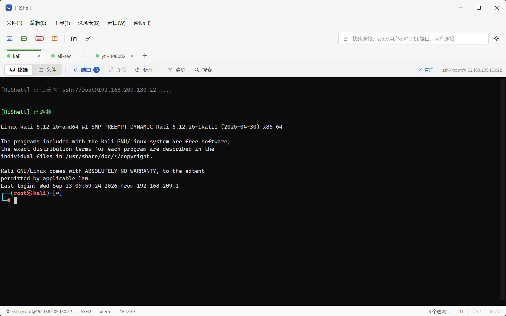
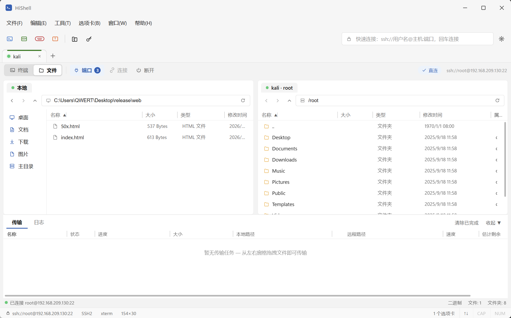
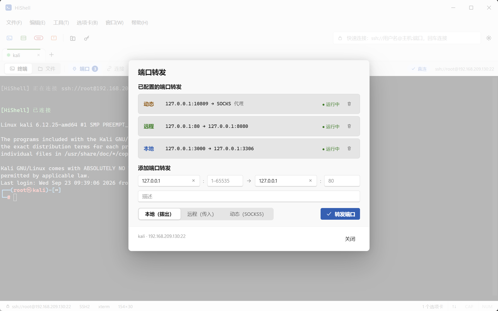
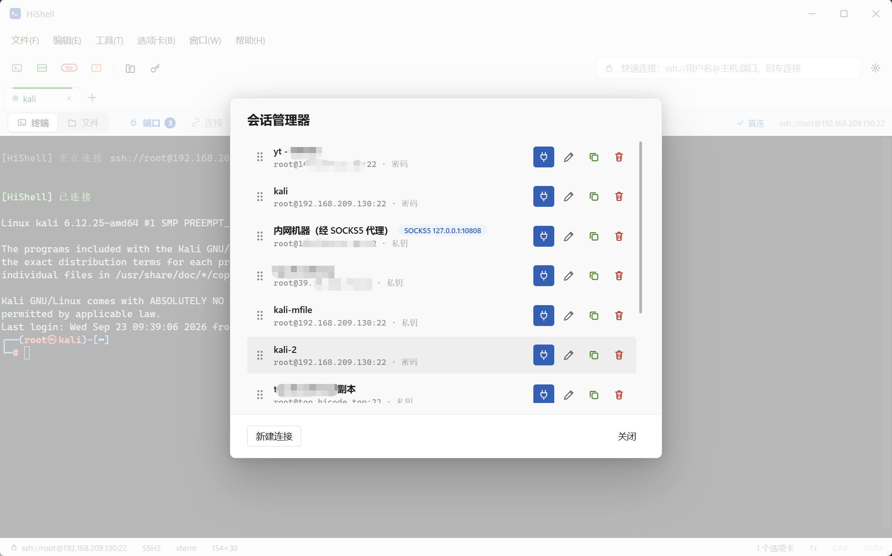
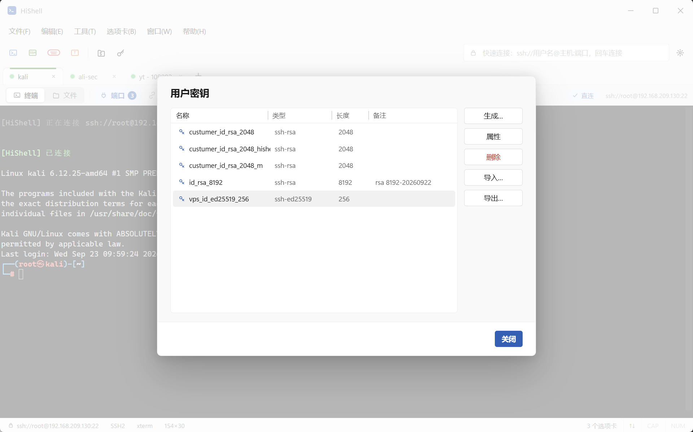
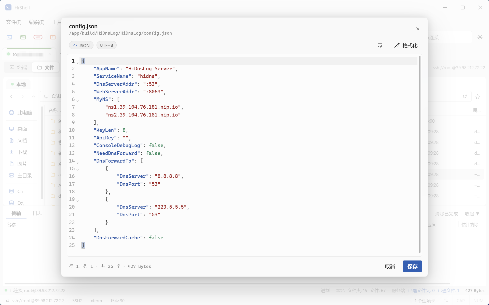
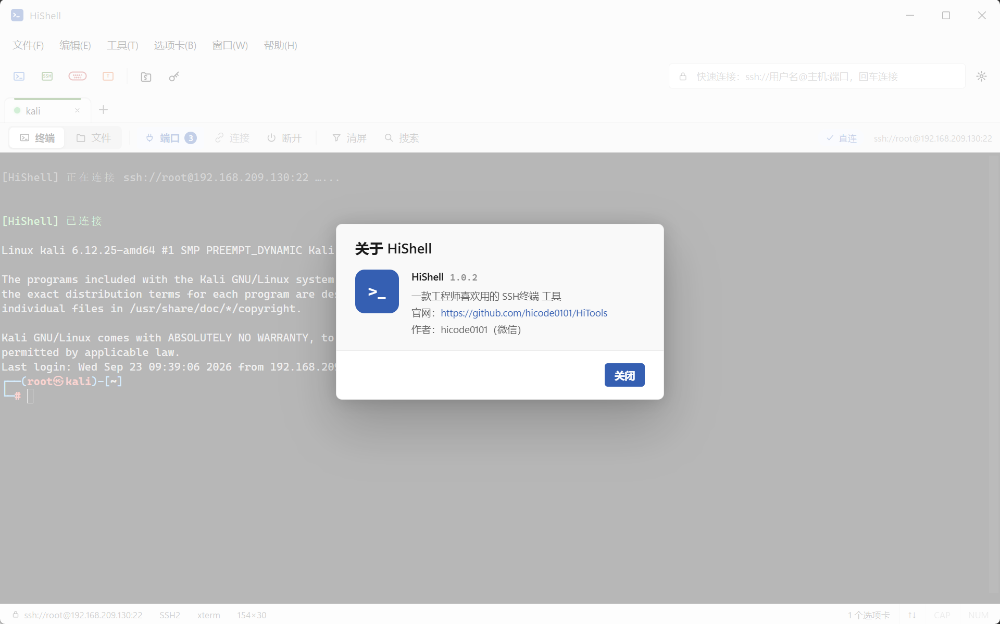

<div align="center">

# HiShell

**一款工程师爱用的 SSH 终端工具 · Windows 11 Fluent Design**

基于 **Tauri 2 + Rust + Vue 3 + xterm.js** 打造，对标 Xshell / Xftp / Tabby。

[](#-跨平台)
[](https://v2.tauri.app/)
[](https://vuejs.org/)
[](https://www.rust-lang.org/)
[](../../releases)

当前状态：**M1–M6 核心功能已实现** —— russh 真实连接、OS 钥匙串凭据、端口转发、SFTP 传输引擎
（断点续传）、用户密钥库、本地终端 PTY、Xshell / Tabby 会话导入、GitHub Actions 多平台自动发布。

[官网 · HiTools](https://github.com/hicode0101/HiTools) · [下载 Release](../../releases) · [问题反馈](../../issues)

</div>

---

## ✨ 功能特性

### 🔌 连接与会话

- **多标签 SSH 终端**：会话状态圆点（绿=已连接 / 灰=断开）、标签**拖拽排序**、复制会话（同一 SSH 连接上开新通道标签，免重复认证）
- **会话管理器**：连接 / 编辑 / 复制 / 删除（二次确认），行首拖拽把手**调整配置顺序**并持久化
- **快速连接**：地址栏输入 `ssh://user@host:port` 回车即连（支持 IPv4 / IPv6 / 域名分派校验）；临时配置不进会话列表，**应用启动时自动清理历史临时配置**（后台异步执行，不影响界面操作）
- **会话导入**：自动扫描 Xshell（.xsh，v5–v8 及旧版目录）与 Tabby（config.yaml）会话，勾选导入、按 主机+端口+用户 去重
- **重连**：断开后一键重连；连不上给出可见错误提示

### 🔐 认证（5 种方式，全界面统一）

| 方式 | 说明 |
|---|---|
| 密码 | 系统账户密码认证，支持「记住密码」 |
| 私钥 | 本地私钥文件（任意路径）+ 口令 |
| 用户密钥 | HiShell **内置密钥库**按名称引用，口令可选记忆，多台服务器共用一把密钥 |
| Keyboard-interactive | 按服务器提示逐条回答（OTP / 双因子场景），已存密码自动填充 password 类提问 |
| Agent | 委托本机 ssh-agent（Windows OpenSSH 命名管道 / Pageant / `SSH_AUTH_SOCK`） |

- **统一认证重试对话框**：认证失败时弹出，可**当场切换认证方式**重试（如密码 → 用户密钥），默认选中配置中的原始方式，顶部显示失败原因与目标主机
- 新建连接 / 快速连接 / 认证重试三处**认证方式与表单布局完全一致**，无额外学习成本

### 🗝️ 密钥与安全

- **用户密钥管理器**：生成 **RSA（2048–8192）/ Ed25519 / ECDSA**，导入 OpenSSH 密钥，查看属性（类型 / 长度 / 指纹），重命名 / 删除 / 导出
- **凭据零落盘**：密码、私钥口令、代理密码全部存入 **OS 钥匙串**（Windows Credential Manager / macOS Keychain / Linux Secret-Service），配置文件中只留「已存储」标记；已存凭据在输入框旁一键清除（🧹 图标）
- **known_hosts 校验**：SHA256 指纹，首次连接信任 / 主机密钥变更强告警（保存 / 仅本次 / 断开）

### 📂 文件传输（SFTP）

- **左右双栏**（本地 / 远程真实目录），桌面 / 文档 / 下载 / 图片 / 主目录快速链接
- **拖拽传输**：双栏互拖、从资源管理器拖入直接上传（取 OS 真实路径）、传输完成后对应窗格**自动刷新**
- 文件列表支持**列宽拖拽调整**、多选、**Delete 键删除**、排序、隐藏文件切换
- **传输队列**：实时进度 / 速度 / 估计剩余时间 / 暂停 / 取消 / **失败断点续传**，附传输日志页签
- **断线保护**：连接断开后所有远程文件操作被拦截并提示，恢复连接即可继续

### 🔀 端口转发与代理

- **本地（拨出）/ 远程（传入）/ 动态（SOCKS5）** 三种转发，实时「运行中」状态
- 会话工具栏「端口」按钮**高亮 + 数量徽标**，一眼识别有转发规则的连接
- **代理连接**：无 / SOCKS5 / HTTP CONNECT / 跳板机（可链式嵌套、防循环引用）/ 自定义 ProxyCommand

### 🖥️ 终端体验

- xterm.js 渲染，**搜索**、清屏、复制 / 粘贴 / 全选（Fluent 风格右键菜单），行列尺寸实时同步后端 PTY
- **本地终端标签**（Windows ConPTY / Unix openpty），开箱即连
- 终端配色方案：深色 / 浅色 / 跟随应用主题；终端字体、字号可调
- 会话内「终端 / 文件」视图切换（未连接时给出 toast 引导）

### 🎨 界面与国际化

- **Windows 11 Fluent Design**：Mica / Acrylic 窗口材质、自绘标题栏、全套自研 Fluent 组件
- 浅色 / 深色 / 跟随系统主题，主题色可调
- **国际化**：跟随系统 / 简体中文 / English，切换即时生效
- 状态栏：协议 / TERM / 行列尺寸 / 标签数 / CAPS·NUM 指示

## 📸 界面预览

| | |
|---|---|
|  |  |
| *多标签 SSH 终端（端口转发徽标 / 搜索 / 状态栏）* | *SFTP 双栏 + 传输队列（进度 / 速度 / 剩余时间）* |
|  |  |
| *端口转发（本地 / 远程 / 动态 SOCKS5）* | *会话管理器（拖拽排序 / 复制 / 连接）* |
|  |  |
| *用户密钥管理器（生成 / 导入 / 导出）* | *在线编辑* |
|  |  |
| *欢迎主页（Fluent Design · Mica 材质）* | *关于* |

## 🌍 跨平台

| 平台 | 状态 | 说明 |
|---|---|---|
| Windows x64 | ✅ 主要目标 | Mica/Acrylic 窗口材质、ConPTY、命名管道 ssh-agent |
| Linux x64 | ✅ | XDG 配置目录、SSH_AUTH_SOCK、secret-service 凭据 |
| macOS Intel / Apple Silicon | ✅ | arm64 / x86_64 分别构建（Intel 版在 arm64 runner 上交叉编译）、Keychain 凭据 |

## 🚀 快速开始

```bash
git clone https://github.com/hicode0101/HiShell.git
cd HiShell
npm install
```

**方式一：桌面应用（完整体验，含 Mica 材质 / 本地目录浏览）**

```bash
npm run tauri dev
```

需要 Rust 工具链（rustup + MSVC Build Tools + WebView2，Win11 自带）。

**方式二：浏览器预览（无需 Rust，mock 模式）**

```bash
npm run dev
# 打开 http://localhost:5173
```

Windows 下也可以**双击 `preview.bat`**：自动启动预览服务并打开浏览器（端口已占用时直接复用）。不编译 Rust、秒级启动，前端改动即时热更新；会话 / 终端 / SFTP / 文件编辑均为内置模拟数据，适合界面与交互的日常预览测试。需要真实 SSH 连接时再用 `build.bat dev`（Rust 增量编译 + 前端热更新）。

### 本地构建（Windows）

双击或在命令行运行 `build.bat`：

```bat
build.bat dev       :: tauri dev 运行完整应用（Rust 增量编译 + 前端热更新，日常调试推荐）
build.bat           :: release 完整打包（NSIS+MSI 安装包，首次较慢）
build.bat debug     :: debug 打包（不优化，编译快，适合本地测试）
build.bat exe       :: 只出绿色版 exe（跳过安装包，最快，增量约 15 秒）
build.bat check     :: 仅类型检查 + cargo check
```

产物位置：

- 安装包：`src-tauri\target\release\bundle\nsis\*.exe`、`src-tauri\target\release\bundle\msi\*.msi`
- 绿色版 exe：`src-tauri\target\debug\HiShell.exe`（debug）或 `src-tauri\target\release\HiShell.exe`

> 提示：首次 NSIS/WiX 打包工具需从 GitHub 下载，网络不通时可用 `build.bat exe` 直接出绿色版测试。

### 常用命令

```bash
npm run tauri build   # 手动完整打包
npm run build         # 仅前端产物 dist/
npm run typecheck     # vue-tsc 类型检查
```

### 自动打包发布（GitHub Actions）

推送 `v*` 标签即可自动完成四平台打包并发布 GitHub Release：

```bash
git tag v0.2.0
git push origin v0.2.0
```

流程（`.github/workflows/release.yml`）：

1. 以 **tag 版本为准**，构建前自动同步版本号到 `package.json`、`src-tauri/tauri.conf.json`、`src-tauri/Cargo.toml`（`scripts/sync-version.mjs`）
2. 四平台矩阵构建：Windows x64（NSIS+MSI 安装包 + **portable zip 绿色版**，解压即用）/ Linux x64（AppImage+deb）/ macOS Apple Silicon（arm64）/ macOS Intel（x86_64）
3. 自动创建 GitHub Release（`HiShell v{tag}`）并上传全部安装包

也支持在 Actions 页面手动触发（workflow_dispatch，输入版本号）。

> 说明：当前未配置代码签名——Windows 首次运行会有 SmartScreen 提示，macOS 需右键打开绕过 Gatekeeper；
> 如需签名，在 workflow 中补充 `APPLE_CERTIFICATE` / Windows 证书等 secrets 即可。

## 🔍 诊断

- 后端日志：`%APPDATA%\hishell\hishell.log`（连接 / 认证 / 主机密钥 / 数据泵全链路）
- 配置目录：`%APPDATA%\hishell\`（profiles.json、known_hosts、用户密钥库），可从「帮助」菜单直达
- 前端调试：以环境变量 `WEBVIEW2_ADDITIONAL_BROWSER_ARGUMENTS="--remote-debugging-port=9222 --remote-allow-origins=*"` 启动 exe，用 `scripts/cdp_*.py` 驱动与检查界面

## 🏗️ 项目结构

```
HiShell/
├── docs/                     # 设计文档 + 截图
├── src/                      # Vue 3 前端
│   ├── api/                  # backend.ts 接口定义 / adapter 双模式（tauri / mock）
│   ├── components/
│   │   ├── terminal/         # TerminalPane + xterm 实例注册表
│   │   ├── sftp/             # 双栏文件管理 + 传输队列
│   │   ├── connect/          # 新建连接 / 快速连接对话框
│   │   └── …                 # 工具栏 / 标签栏 / 会话与密钥管理器
│   ├── stores/               # Pinia：sessions / profiles / transfers / settings / events
│   ├── ui/                   # 自研 Fluent 组件库（Button / Dialog / ComboBox / DataGrid…）
│   ├── i18n/                 # zh-CN / en-US
│   └── views/                # MainView / SettingsView
├── src-tauri/
│   └── src/
│       ├── ssh/              # russh 会话管理：认证 / 代理 / 跳板机 / 端口转发 / 数据泵
│       ├── commands/         # Tauri 命令层（fs / ssh / sftp / profiles / forwards / userkeys …）
│       ├── profile_store.rs  # 连接配置持久化（含快速连接 temporary 配置与启动自动清理）
│       ├── secrets.rs        # OS 钥匙串凭据
│       └── known_hosts.rs    # 主机密钥校验
└── scripts/                  # CDP E2E 驱动脚本 / 版本同步
```

## 📚 文档

- [docs/tabby-功能分析报告.md](docs/tabby-功能分析报告.md) —— Tabby 源码功能分析（SSH 连接 / 认证 / 端口转发 / SFTP / 配置系统）
- [docs/hishell-设计方案.md](docs/hishell-设计方案.md) —— HiShell 架构设计、前后端通信协议、Fluent UI 规范、里程碑

## 🗺️ 里程碑

| 阶段 | 内容 | 状态 |
|---|---|---|
| M0 | 界面原型 | ✅ |
| M1 | russh 真实连接（认证 / 代理 / 跳板机 / known_hosts / 会话复用） | ✅ |
| M2 | Profile 持久化 + keyring 凭据 | ✅ |
| M3 | 端口转发（本地 / 远程 / 动态 SOCKS5） | ✅ |
| M4 | SFTP 真实传输（递归目录展开、暂停 / 取消） | ✅ |
| M5 | 本地 PTY 终端 + 终端增强（搜索 / 配色方案）+ **断点续传** + **会话导入器（Xshell / Tabby）** | ✅ |
| M6 | 打包分发（GitHub Actions 四平台自动发布） | ✅ 自动更新待接入 tauri-plugin-updater |

**Roadmap**：ZMODEM（rz/sz）· 终端分屏 · WebGL 渲染器 · iTerm 社区配色集 · 自动更新签名 · Serial / Telnet 终端

---

<div align="center">

**HiShell** · 一款工程师爱用的 SSH 终端工具

[官网 HiTools](https://github.com/hicode0101/HiTools) · [问题反馈](../../issues)

</div>
